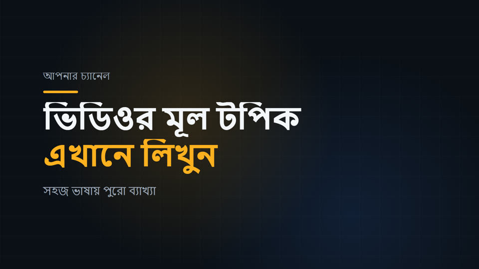
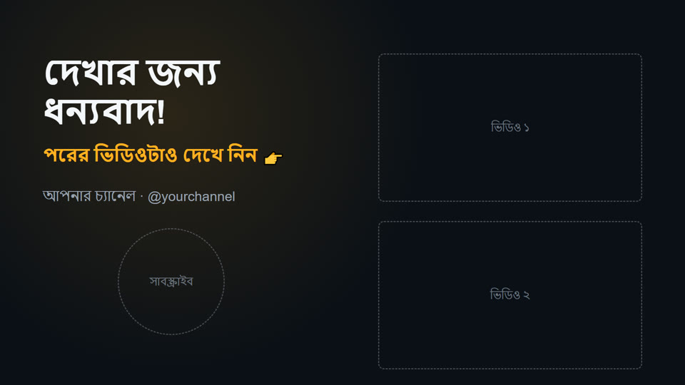
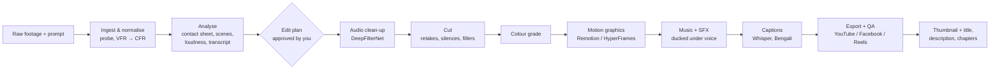

# MozahidFlow

**Raw video + a prompt → a finished, professional video for YouTube, Facebook and Instagram Reels.**

MozahidFlow is a local video-production workspace driven by [Claude Code](https://claude.com/claude-code).
You drop in raw footage, or only a topic or a product link, and describe what you want. Claude does the rest
on your own Windows PC with open-source tools:
- analyses the footage
- proposes an edit plan
- cuts, cleans the audio, colour-grades and adds Bengali captions
- builds motion graphics, mixes licensed music and sound effects
- exports platform-ready files with a thumbnail, titles, a description and chapters

Built for Bengali (বাংলা) creators: every template, font and caption path handles Bengali conjuncts correctly.

> **বাংলায় সংক্ষেপে:** এটা একটা লোকাল ভিডিও এডিটিং সেটআপ। raw ভিডিও আর একটা প্রম্পট দিলে Claude Code নিজেই
> বিশ্লেষণ, কাটা, অডিও পরিষ্কার, কালার গ্রেডিং, বাংলা সাবটাইটেল, মোশন গ্রাফিক্স, মিউজিক, থাম্বনেইল আর
> YouTube/Facebook/Reels-এর এক্সপোর্ট করে দেয়। সব কিছু আপনার PC-তেই চলে। ব্যবহারের নিয়ম: [HOW-TO-USE.md](HOW-TO-USE.md)।

## Template previews

All rendered locally from [`studio/`](studio/) (Remotion).

| Intro | Thumbnail (1280×720) | Outro with end-screen guides |
|---|---|---|
|  |  |  |
| **Key points (alpha overlay)** | **Lower third (alpha overlay)** | **Subscribe reminder (alpha overlay)** |
|  |  |  |

The overlays render as transparent ProRes 4444; the white background in the previews is where your footage shows through.

## What it can make

- **Topic videos and tutorials**: screen recordings or talking head, with silence and filler removal,
  Bengali captions, chapter cards, callouts, an intro and an outro.
- **SaaS / tech product promos**: from a product URL, script or screen recording, with zooms, highlights and
  UI animations.
- **Faceless animated explainers**: no footage needed; typography, diagrams and data-viz built per scene.
- **Premium 9:16 product ads** for Facebook and Instagram Reels: colour grade, kinetic text, SFX and music.
- **Short motion graphics**: logo stings, lower thirds, stat count-ups, kinetic typography.

## How it works



The full playbook Claude follows is in [`CLAUDE.md`](CLAUDE.md).

## Requirements

- Windows 10 or 11, about 10 GB free disk space (Whisper models go under your user profile).
- [Claude Code](https://claude.com/claude-code) (VS Code extension or CLI).
- Internet for the first setup only. Editing runs offline; no footage is uploaded anywhere.

The workspace was built and tested on a modest laptop (Intel i5-5200U, 2 cores, 12 GB RAM, no GPU). Long renders
and transcription run in the background there; any newer PC is faster.

## Setup

```powershell
git clone https://github.com/Mozahid-AIUB/MozahidFlow.git D:\Video
cd D:\Video
powershell -ExecutionPolicy Bypass -File .\setup.ps1             # add -WithLargeModel for Whisper large-v3
```

`setup.ps1` installs (or skips if present):
- Git, Node.js LTS, FFmpeg and uv (via winget)
- a Python 3.12 venv with pinned packages
- the DeepFilterNet binary (SHA-256 checked)
- the Remotion agent skills at a pinned commit
- the npm dependencies for `studio/`, `hyperframes/` and Playwright
- the Whisper models

Then open the folder in VS Code, start Claude Code, and give it your channel name, @handle, logo and colours once.
Claude fills [`studio/src/brand.ts`](studio/src/brand.ts) with them.

## Usage

Talk to Claude in Bengali or English. Examples:

```text
D:\Downloads\watch.mp4 — edit this luxury wristwatch video as a premium ad for Facebook and Instagram Reels.
Analyse the whole video first and suggest improvements. Keep 9:16.
```

```text
D:\Recordings\lesson-5.mp4 — আমার YouTube টিউটোরিয়াল। ভুল আর চুপ থাকা অংশ কেটে দাও, বাংলা সাবটাইটেল,
ইন্ট্রো, চ্যাপ্টার, আউট্রো দাও। থাম্বনেইল আর টাইটেল-ডেসক্রিপশনও বানাও।
```

```text
Make a 45-second promo for https://example.com (our SaaS). Use our logo in assets\brand.
```

Each video gets its own folder, `projects\YYYY-MM-DD_<slug>\`:
- `raw\`: your originals, never modified
- `work\`: intermediates
- `out\`: deliverables
- `brief.md`: the plan

## Repository layout

```
CLAUDE.md            playbook Claude follows (workflow, paths, rules)
HOW-TO-USE.md        Bengali user guide
setup.ps1            one-shot installer
studio/              Remotion project: Bengali-ready templates (Intro, ChapterCard, LowerThird, Callout,
                     KeyPoints, SubscribeReminder, Outro, Thumbnail) + brand.ts
hyperframes/         HyperFrames workspace (pinned CLI, local-only wrappers hf.cmd / hf)
tools/scripts/       new_project.py, transcribe.py (faster-whisper → txt/srt/words), clean_audio.py
tools/grading/       colour-grade request templates + a self-made warm split-tone LUT
tools/bn_fillers.txt Bengali/English filler-word list for silence removal
assets/fonts/        OFL fonts: Hind Siliguri, Anek Bangla, Noto Sans/Serif Bengali, Baloo Da 2, Tiro Bangla,
                     Galada, Inter, Poppins, Montserrat, Bebas Neue, JetBrains Mono
assets/music/        README + LICENSES only (audio files are not redistributed, see below)
.claude/skills/      Claude Code skills (see credits)
docs/images/         README previews
```

## Credits and licences

| Component | Source | Licence | In this repo |
|---|---|---|---|
| ffmpeg-skill | [kajisho5/ffmpeg-skill](https://github.com/kajisho5/ffmpeg-skill) | MIT | vendored (`.claude/skills/ffmpeg-skill`) |
| color-grading | [kajisho5/color-grading-skill](https://github.com/kajisho5/color-grading-skill) | MIT | vendored; description quoted so it parses as YAML |
| motion-broll, sound-effects | [Barty-Bart/motion-graphics](https://github.com/Barty-Bart/motion-graphics) | MIT (SFX CC0, fonts OFL) | vendored |
| Remotion agent skills | [remotion-dev/skills](https://github.com/remotion-dev/skills) | none stated | **not** vendored; `setup.ps1` fetches a pinned commit |
| HyperFrames + skills | [heygen-com/hyperframes](https://github.com/heygen-com/hyperframes) | Apache-2.0 | installed by `setup.ps1` |
| Remotion | [remotion.dev](https://www.remotion.dev) | Remotion licence (free for individuals and small teams) | npm dependency |
| FFmpeg | [ffmpeg.org](https://ffmpeg.org) (gyan.dev build) | GPL | installed by winget |
| faster-whisper / Whisper | [SYSTRAN/faster-whisper](https://github.com/SYSTRAN/faster-whisper) | MIT | pip dependency |
| DeepFilterNet | [Rikorose/DeepFilterNet](https://github.com/Rikorose/DeepFilterNet) | MIT / Apache-2.0 | downloaded by `setup.ps1` |
| Fonts | [Google Fonts](https://github.com/google/fonts) | SIL OFL 1.1 | `assets/fonts` |

**Music:** the starter library (Mixkit Free License + CC0) is listed in
[`assets/music/LICENSES.md`](assets/music/LICENSES.md). The audio files are **not** in this repo, because
Mixkit forbids redistribution. Download them from the links there. Never register these tracks with Content
ID or Facebook Rights Manager.

## Notes

- Everything runs locally. HyperFrames telemetry, update checks and auto-installs are switched off by the
  `hf` / `hf.cmd` wrappers and the `hyperframes/.env` that `setup.ps1` writes.
- `faster-whisper 1.2.1` needs `av==16.0.1` (16.1+ removed an argument it uses). The pin is in
  `tools/requirements.txt`.
- Use your own voice for voice-overs, or an AI TTS service you have an account for. None is bundled.
